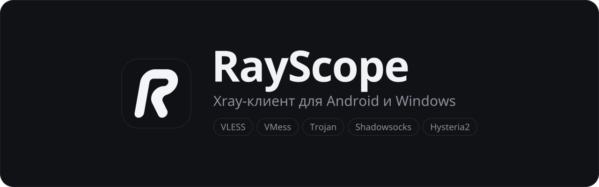

<p align="center">
  
</p>

<p align="center">
  <a href="https://github.com/kabiriyer3-cmyk/RayScope/releases/latest"></a>
  
  
  
  <a href="https://github.com/XTLS/Xray-core"></a>
</p>

<p align="center">
  <a href="https://github.com/kabiriyer3-cmyk/RayScope/releases/latest"><b>Скачать</b></a>
  &nbsp;·&nbsp;
  <a href="#что-умеет">Что умеет</a>
  &nbsp;·&nbsp;
  <a href="#частые-вопросы">Частые вопросы</a>
  &nbsp;·&nbsp;
  <a href="#сборка-из-исходников">Сборка</a>
</p>

<br>

RayScope подключается к серверам VLESS, VMess, Trojan, Shadowsocks и Hysteria2, а также к обычным прокси SOCKS5 и HTTP через ядро Xray. Работает на Android, Windows и Linux. Подписки берёт те же, что Happ, v2rayNG, v2RayTun и Hiddify, включая ссылки из ботов и панелей вроде Marzban, 3x-ui и Remnawave.

Основная идея: показать, что на самом деле происходит с соединением. Какие серверы живые, поменялся ли IP, открываются ли YouTube и Telegram через туннель, насколько сервер стабилен по прошлым проверкам.

> [!NOTE]
> RayScope не продаёт и не раздаёт серверы. Нужна своя подписка или ссылка от провайдера.

## Установка

Все сборки лежат в [Releases](https://github.com/kabiriyer3-cmyk/RayScope/releases/latest). Их собирает GitHub Actions прямо из этого репозитория, контрольные суммы в `SHA256SUMS.txt`.

### Android

| Файл | Кому |
|---|---|
| `RayScope-…-arm64-v8a.apk` | почти все телефоны последних лет, берите его |
| `RayScope-…-armeabi-v7a.apk` | старые и бюджетные 32-битные устройства |
| `RayScope-…-universal.apk` | если не знаете, какой нужен: подходит всем, но весит больше |
| `RayScope-…-x86_64.apk`, `…-x86.apk` | эмуляторы и Android на компьютере |

Нужен Android 7.0 или новее. При первом подключении система спросит разрешение на VPN. Новая версия ставится поверх старой, серверы и настройки сохраняются.

### Windows

| Файл | Что это |
|---|---|
| `RayScope-Setup-….exe` | установщик, подойдёт большинству |
| `RayScope-…-windows-x64-portable.zip` | портативная версия: распаковать в любую папку и запустить `RayScope.exe` |

Java и ядро уже внутри, отдельно ничего ставить не нужно. Установщик не просит прав администратора и ставит программу в `%LOCALAPPDATA%\Programs\RayScope`, удалить её можно через «Параметры → Приложения».

Файлы не подписаны платным сертификатом, поэтому SmartScreen может показать предупреждение. Нажмите «Подробнее», затем «Выполнить в любом случае».

### Linux

| Файл | Что это |
|---|---|
| `rayscope_…_amd64.deb` | Debian, Ubuntu, Mint и всё, что на них основано |
| `RayScope-…-linux-x64.tar.gz` | любой 64-битный дистрибутив: распаковать и запустить `./rayscope` |

```sh
sudo apt install ./rayscope_*_amd64.deb
```

Из архива программа запускается без установки, `./install.sh` добавит её в меню приложений. Java и ядра уже внутри. Системный прокси выставляется в настройках GNOME и KDE. Для режима TUN нужен `pkexec` (есть почти везде): при включении система спросит пароль администратора. Трей появляется, если окружение его поддерживает; в чистом GNOME для этого нужно расширение AppIndicator.

### Первый запуск

1. Скопируйте ссылку на подписку (`https://…`), ссылки на серверы (`vless://…`, `ss://…` и так далее) или список прокси.
2. На вкладке «Серверы» нажмите «Вставить из буфера». Подписку можно добавить и через «+».
3. Нажмите «Пинг», выберите сервер с зелёной задержкой и включите подключение.

## Что умеет

**Подписки и серверы**

- Обычные подписки (base64 или списком ссылок), а также Xray JSON и sing-box JSON, которые отдают v2RayTun, Happ и Hiddify. Конфиги с балансировщиком разбираются на отдельные серверы.
- Остаток трафика и срок подписки, автообновление, выбор User-Agent для панелей, которые отдают разным клиентам разное.
- Ссылки импорта из Happ, v2RayTun, Hiddify, Streisand, v2rayNG, Clash и sing-box, а также `sub://` и `rayscope://`.
- Протоколы: VLESS (в том числе REALITY и XTLS Vision), VMess, Trojan, Shadowsocks, Hysteria2. Транспорты TCP, WebSocket, gRPC, HTTPUpgrade, XHTTP.
- Обычные прокси SOCKS5 и HTTP(S): `socks5://логин:пароль@адрес:порт`, `http://…`, `tg://socks`, `t.me/socks` и списки из прокси-магазинов вида `адрес:порт:логин:пароль`. Строки без схемы считаются SOCKS5, для HTTP допишите `http://`.
- Избранное, поиск, фильтры «рабочие», «нерабочие», «не проверены», сортировка по пингу, имени и стабильности.

**Проверка**

- Пинг на выбор: настоящий HTTP-запрос через ядро, TCP-рукопожатие или ICMP. Рядом с цифрой видно, каким способом она получена.
- «Лучший сервер»: проверить все и подключиться к самому быстрому.
- Проверка IP: ваш настоящий адрес и адрес через VPN, страна, город, провайдер. Сразу понятно, идёт ли трафик через туннель.
- Доступность YouTube, Instagram, Telegram, ChatGPT, Discord и X напрямую и через VPN.
- Стабильность сервера по истории проверок.

**Подключение**

- Windows и Linux: системный прокси, TUN (весь трафик компьютера, включая игры и Telegram) или только локальный прокси HTTP `127.0.0.1:10809` и SOCKS5 `127.0.0.1:10808`.
- Android: раздельное туннелирование по приложениям, плитка в шторке, виджеты 2×2 и 4×1, уведомление со скоростью.
- Российские сайты напрямую, блокировка рекламы и QUIC, свои правила «напрямую» и «блокировать».
- TLS-фрагментация и uTLS-отпечаток, если провайдер режет соединения через DPI.
- DNS: Cloudflare, Google, Quad9, AdGuard, Яндекс, DoH или свои адреса. Mux и TCP Fast Open.

**Интерфейс**

- Светлая и тёмная тема, 8 цветов акцента. На Android ещё AMOLED, размер текста, скругления и компактный список.
- На компьютере: трей, автозапуск вместе с системой, меню команд по <kbd>Ctrl</kbd>+<kbd>K</kbd>, разделы по <kbd>Ctrl</kbd>+<kbd>1</kbd>…<kbd>4</kbd>.
- Если программа закрылась или упала, системный прокси возвращается как был, интернет не пропадает.

## Частые вопросы

<details>
<summary><b>Сервер красный, но через него всё открывается</b></summary>
<br>

Скорее всего выбран пинг ICMP или TCP. Многие серверы не отвечают на ICMP, а TCP проверяет только то, что порт открыт. Честнее всего HTTP: запрос идёт через ядро так же, как обычный трафик. Способ меняется в меню «⋯» на вкладке «Серверы» или в настройках, раздел «Пинг и проверка».

</details>

<details>
<summary><b>На компьютере браузер работает, а игры, Telegram или голос в Discord нет</b></summary>
<br>

Эти программы не смотрят на системный прокси. Включите режим TUN на главной: он заворачивает в VPN весь трафик компьютера. Для TUN нужны права администратора: на Windows RayScope предложит перезапуститься с ними, на Linux система спросит пароль.

</details>

<details>
<summary><b>Подписка добавилась пустой или с ошибкой</b></summary>
<br>

Некоторые панели отдают разные конфиги разным клиентам. Попробуйте другой User-Agent в настройках, раздел «Подписки». Зашифрованные ссылки Happ (`happ://crypt…`) не поддерживаются, попросите у провайдера обычную ссылку на подписку.

</details>

<details>
<summary><b>Где хранятся серверы и настройки</b></summary>
<br>

На Windows в `%APPDATA%\RayScope`, на Linux в `~/.config/RayScope`, папку можно открыть из настроек. На Android внутри приложения. Перенести их на другой телефон можно через «Настройки → Резервная копия».

</details>

<details>
<summary><b>Как обновиться</b></summary>
<br>

Скачайте новую версию из Releases и поставьте поверх. На Windows установщик сам заменит старую версию, портативную достаточно распаковать в ту же папку. На Linux поставьте новый `.deb` или распакуйте архив на место старого.

</details>

## Сообщить о проблеме

Откройте [issue](https://github.com/kabiriyer3-cmyk/RayScope/issues/new) и напишите, что произошло, на какой платформе и в какой версии (её видно в «Настройки → О программе»). Очень помогает журнал ядра: он появляется в режиме разработчика.

> [!WARNING]
> Не выкладывайте ссылки на подписки и серверы, в них ваши ключи доступа.

<details>
<summary><b>Режим разработчика</b></summary>
<br>

Обычный интерфейс показывает только то, что нужно каждый день. Чтобы открыть технические подробности, нажмите семь раз на «Версия» в настройках.

Появятся журнал ядра, TCP-пинг рядом с основным, полные параметры сервера и его JSON, ASN и источник ответа в проверке IP, история проверок, domain strategy, sniffing, уровень логов и ручные параметры фрагментации. На Android ещё keep-alive, таймауты ядра, XUDP и QUIC в Mux. Выключается там же, тумблером.

</details>

## Сборка из исходников

<details>
<summary><b>Как это собирается</b></summary>
<br>

Каждый push в `main` запускает `.github/workflows/build.yml`. Сам workflow короткий, вся логика в `ci/*.sh`:

1. скачивает ядро `libv2ray.aar` из [AndroidLibXrayLite](https://github.com/2dust/AndroidLibXrayLite);
2. собирает подписанные APK под arm64-v8a, armeabi-v7a, x86_64, x86 и universal;
3. собирает Windows-версию (модуль `desktop`, Compose Multiplatform), лаунчер `RayScope.exe` (mingw-w64) и установщик (NSIS), кладёт рядом JRE 17, `xray.exe` и `sing-box.exe` для TUN;
4. из тех же файлов собирает Linux-версию: архив и `.deb` с JRE 17, `xray` и `sing-box` (`ci/linux.sh`);
5. публикует релиз с номером `1.2.<номер сборки>` и файлом `SHA256SUMS.txt`;
6. если сборка упала, открывает issue с выдержкой из лога.

</details>

<details>
<summary><b>Локально</b></summary>
<br>

Нужен JDK 17.

- **Android**: положите `libv2ray.aar` в `app/libs/` и откройте проект в Android Studio. Без переменных окружения release-сборка подписывается debug-ключом.
- **Windows и Linux**: `gradle :desktop:run`. Рядом с рабочей папкой должна лежать папка `core` с `xray.exe` (на Linux `xray`) и geo-файлами.

</details>

<details>
<summary><b>Свой ключ подписи для APK</b></summary>
<br>

По умолчанию используется открытый ключ из `keystore/`, чтобы обновления ставились поверх. В форке лучше завести свой и добавить секреты `KEYSTORE_BASE64`, `KEYSTORE_PASSWORD`, `KEY_ALIAS`, `KEY_PASSWORD`:

```sh
keytool -genkeypair -keystore my.p12 -storetype PKCS12 -alias mykey -keyalg RSA -keysize 2048 -validity 10000
base64 -w0 my.p12   # это значение для KEYSTORE_BASE64
```

</details>

## Сторонние компоненты

- [Xray-core](https://github.com/XTLS/Xray-core), MPL-2.0. На Android через [AndroidLibXrayLite](https://github.com/2dust/AndroidLibXrayLite).
- [sing-box](https://github.com/SagerNet/sing-box), GPL-3.0, в сборках для Windows и Linux для режима TUN.
- [Eclipse Temurin](https://adoptium.net) JRE, GPLv2 с Classpath Exception, в сборках для Windows и Linux.
- Иконки нарисованы по мотивам [Lucide](https://lucide.dev), ISC.

Участники проекта перечислены в [CONTRIBUTORS.md](CONTRIBUTORS.md).
